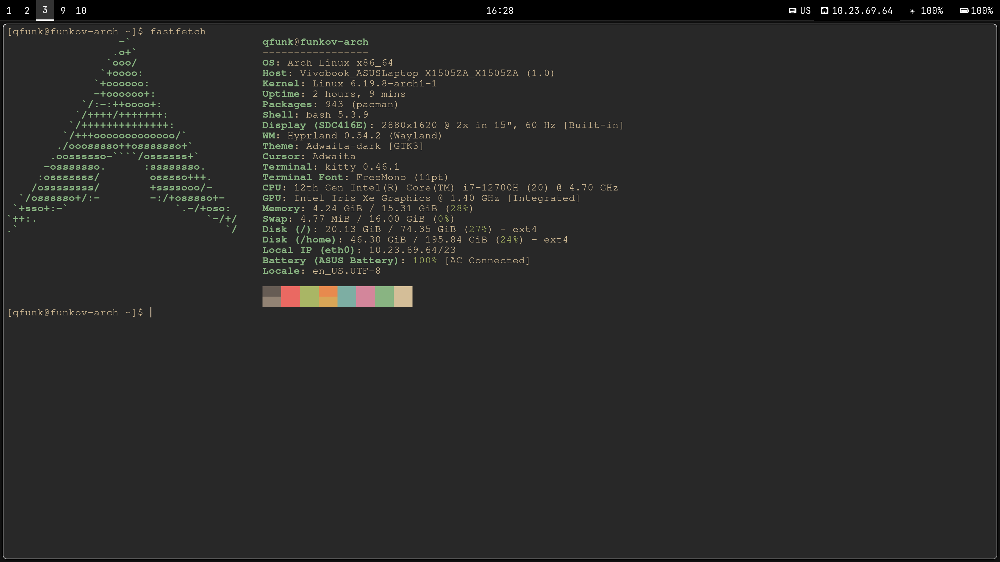
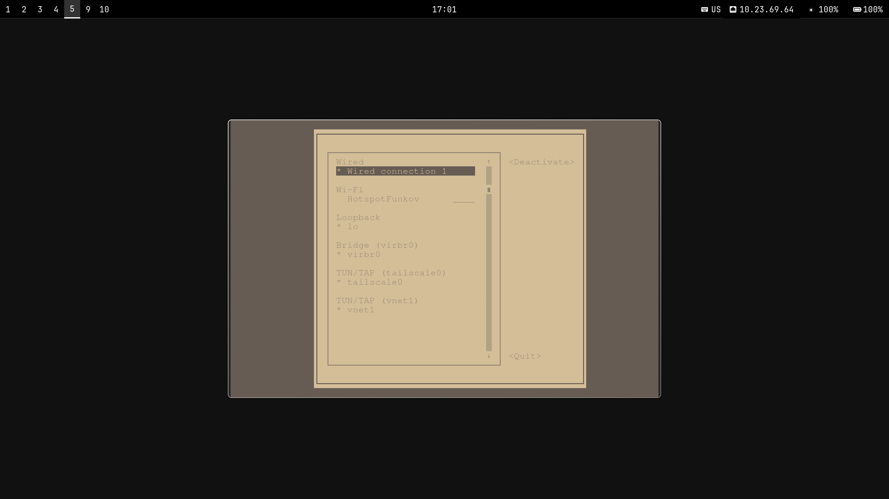

# arch-dots
## 1. Generate SSH Key
```bash
ssh-keygen -t ed25519 -C "you@example.com"
```

Press Enter to save the key in the default location.
Copy your public key to the clipboard:

```bash
cat ~/.ssh/id_ed25519.pub
```
Add this key to GitHub settings under SSH and GPG keys.

## 2. Clone the Repository

Clone the repository using SSH:
```bash
git clone git@github.com:qfunky/arch-dots.git ~/.dotfiles
cd ~/.dotfiles
```

## 3. Install dotfiles

Install dotfiles using shell script.
```bash
./install.sh
```
## Screenshots

Fastfetch


Throne (need to install with yay after reboot)


Nmtui


Clipboard

