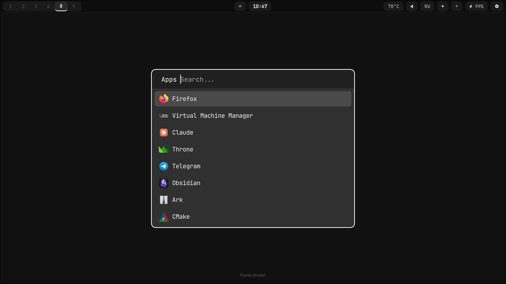
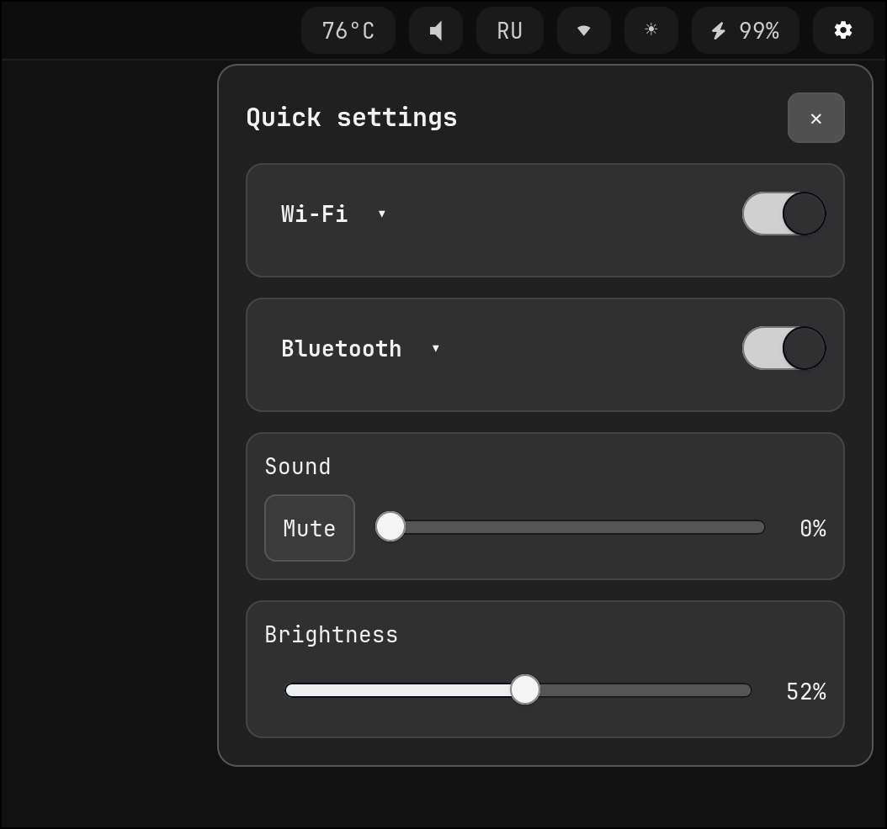
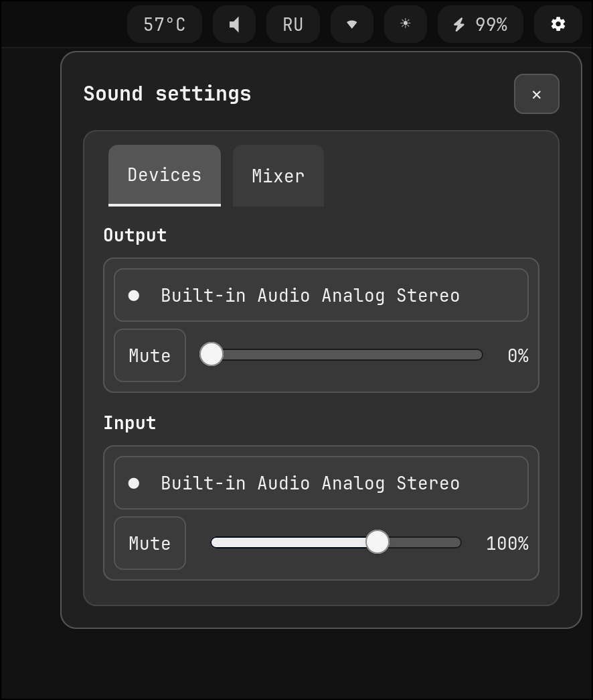
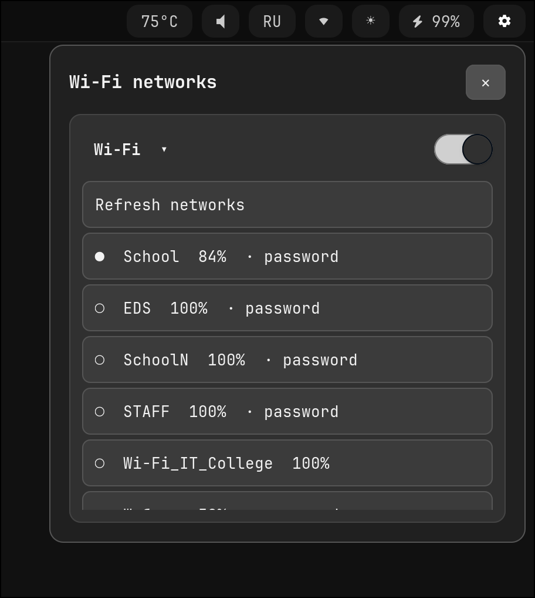
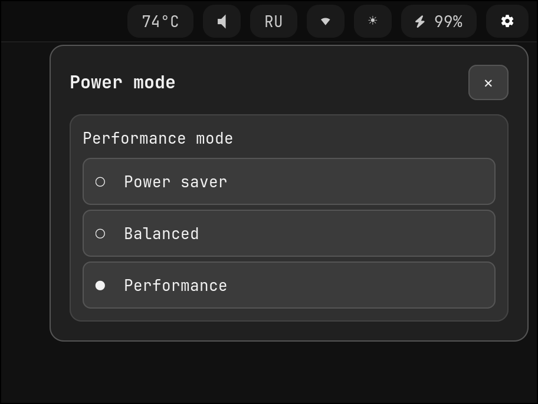
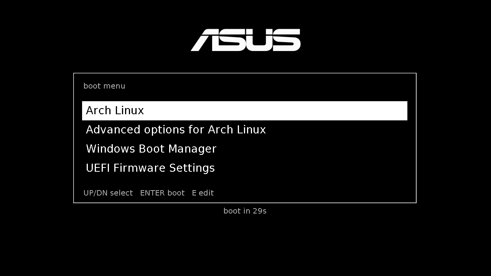
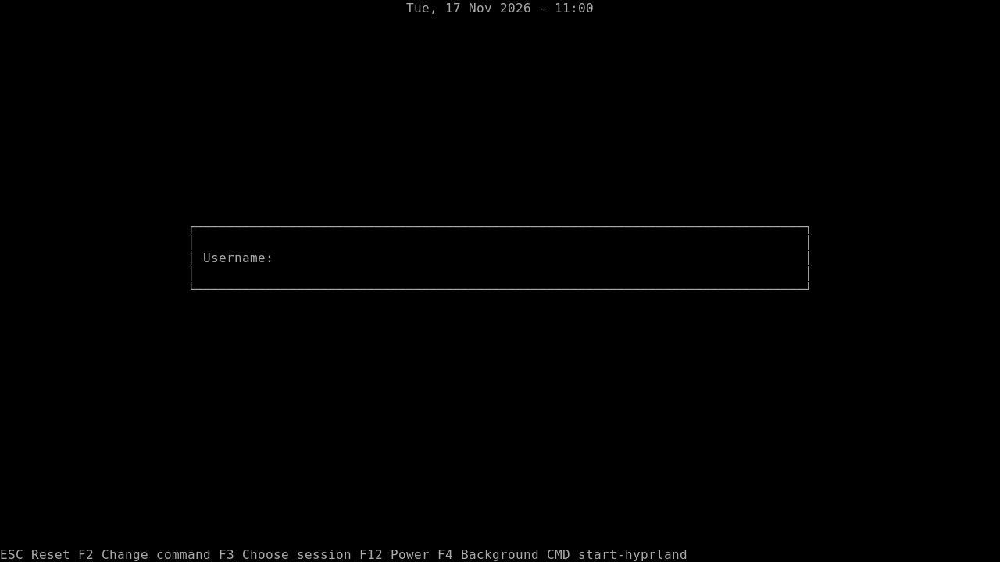

# arch-dots

Portable Arch Linux laptop configuration. Hyprland, a monochrome desktop,
ThinkGRUB and an Arch Linux boot splash.

## Requirements

- Arch Linux, x86-64.
- A working graphics driver and network connection.
- An existing GRUB + mkinitcpio setup for boot styling.

GPU drivers, Secure Boot and disk encryption remain machine-specific.
Other bootloaders are left unchanged.

## Installation

```sh
git clone https://github.com/funkovx/arch-dots.git ~/.dotfiles
cd ~/.dotfiles
./install.sh
```

| Profile | Configuration |
| --- | --- |
| Minimal | Base tools, Zsh, NetworkManager, fastfetch, Plymouth |
| Extended | Minimal profile plus Hyprland, Waybar, Rofi, greetd/tuigreet, desktop applications and KVM tools |

Existing configuration is backed up before linking. Boot files are validated
before replacement. The installer does not reboot automatically.

Both profiles ask whether to install the GRUB theme. Logo selection is
automatic: ThinkPad, ASUS or no logo. Declining preserves the current theme.

## Synchronization

```sh
./sync.sh
```

Updates use fast-forward only. Configuration links follow the installed
profile.

## Screenshots

Rofi



| Quick settings | Sound |
| --- | --- |
|  |  |

| Wi-Fi | Power |
| --- | --- |
|  |  |

GRUB



Plymouth


Tuigreet



## References

- [Hyprland](https://hypr.land/)
- [ThinkGRUB](https://github.com/mschiller890/ThinkGRUB) — MIT; license included with the theme.
- [Plymouth](https://www.freedesktop.org/wiki/Software/Plymouth/)
