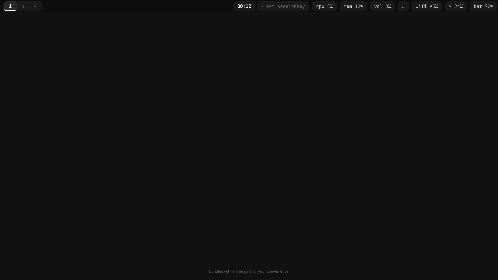
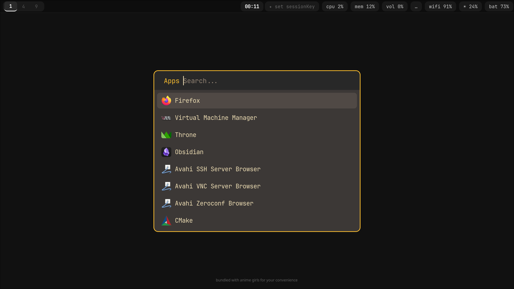
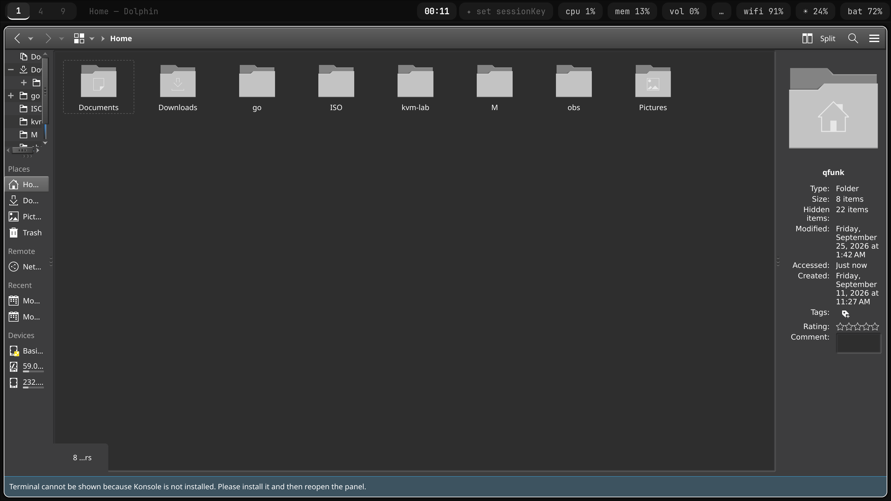

# arch-dots

My Arch Linux setup: Hyprland on Wayland with a dark Gruvbox-inspired look, plus a one-shot installer that turns a fresh Arch install into a working desktop.


## What's inside

| Area | Tools |
| --- | --- |
| Compositor | Hyprland (`hyprland.conf` and the newer Lua config for 0.55+), hypridle, hyprlock, hyprpaper |
| Bar and launcher | Waybar with a custom Claude usage module, Rofi (Gruvbox Dark theme) |
| Terminal and shell | kitty, Zsh, Oh My Zsh, Powerlevel10k |
| Login | greetd + tuigreet, starts Hyprland directly |
| Apps | Dolphin, Kvantum theming for Qt, CopyQ clipboard manager, imv, zathura |
| Input | libinput-gestures for touchpad swipes |
| Virtualization | QEMU/KVM with libvirt and virt-manager |

## Install

On a fresh Arch install:

```bash
git clone https://github.com/funkovx/arch-dots.git ~/.dotfiles
cd ~/.dotfiles
./install.sh
```

The script asks for an install type:

- **Minimal**: base tools, Zsh, NetworkManager, fastfetch.
- **Extended**: everything above plus the Hyprland desktop, greetd (replaces SDDM), fonts, VS Code, Telegram, KVM and AUR packages via `yay`.

It then symlinks every config into `~/.config`, sets Zsh as the default shell and reboots.

## Keeping machines in sync

```bash
./sync.sh
```

Pulls the latest commit, re-links all configs and reloads Hyprland.

## Waybar Claude usage module

`.config/waybar/scripts/claude-limits.py` shows the current claude.ai session and weekly usage in the bar. It reads the session key from `~/.config/claude-limits-widget/secret.env`, which is git-ignored and never committed. Setup steps are in the script header. A macOS version lives in [claude-limits-swiftbar](https://github.com/funkovx/claude-limits-swiftbar).

## Screenshots

**Clean desktop** with the Waybar panel: workspaces, clock, Claude usage, CPU, memory, volume, Wi-Fi, brightness and battery



**Rofi app launcher**



**Dolphin** file manager with Kvantum theming



**nmtui in a floating window**


## Notes

- Built for a 2880×1620 laptop panel at 2× scaling. Change the `monitor` line in the Hyprland config for other displays.
- Private app data (VPN client config, KDE session files, secrets) is excluded in `.gitignore`.
